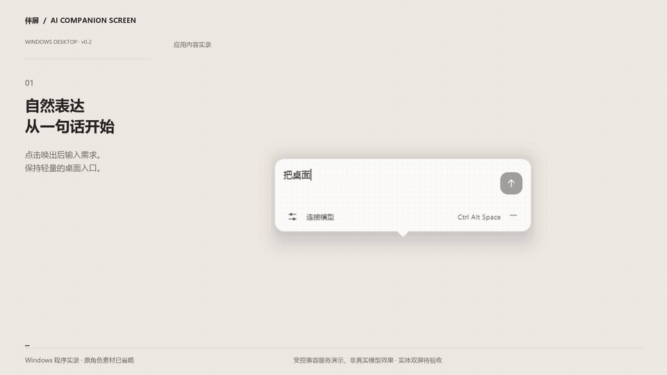

# 伴屏 v0.2.1 公开展示材料

Windows 桌面软件作品 · 2026-10-21 较早历史快照

当前角色已统一原黑色角色，最新源码见[统一更新](../black-character-update-2026-10-21/README.md)。本目录压缩包保留当时状态，不代表当前角色代码。

- [下载完整材料包](banping-v0.2.1-public-submission.zip)（约 2.7 MB） / [SHA256](banping-v0.2.1-public-submission.zip.sha256)
- [六页作品说明 PDF](materials/01-作品说明/伴屏-作品展示说明.pdf)
- [可编辑说明文本](materials/01-作品说明/作品说明-可编辑文本.txt) / [投稿文案与 60 秒口播](materials/01-作品说明/投稿文案与60秒口播.txt)
- [7 张界面图及演示](materials/02-界面与演示) / [29.4 秒无声 MP4](materials/02-界面与演示/伴屏-v0.2-Windows实录-受控服务演示.mp4)
- [AI 实践与测试佐证](materials/03-AI实践佐证)
- [公开源码快照与复现说明](materials/04-作品源码)
- [交付检查记录](materials/交付检查记录.txt) / [全部材料校验清单](materials/提交文件清单与SHA256.json)

实际 EXE 应用窗口实录，原角色仅在隔离演示中隐藏。回复来自本机受控兼容服务，不是真实模型效果；未采集用户桌面。当前仅有单屏实录，实体双屏、混合缩放、拔插与真实视觉模型待验收。没有虚构实物照片。

本机专用角色 EXE 不随公开材料分发；作品文件以可复现源码交付。源码生产构建使用项目原创角色。公开提交不等于已选择开源许可证。
